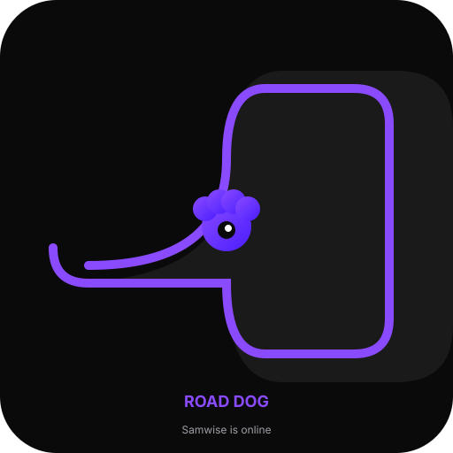
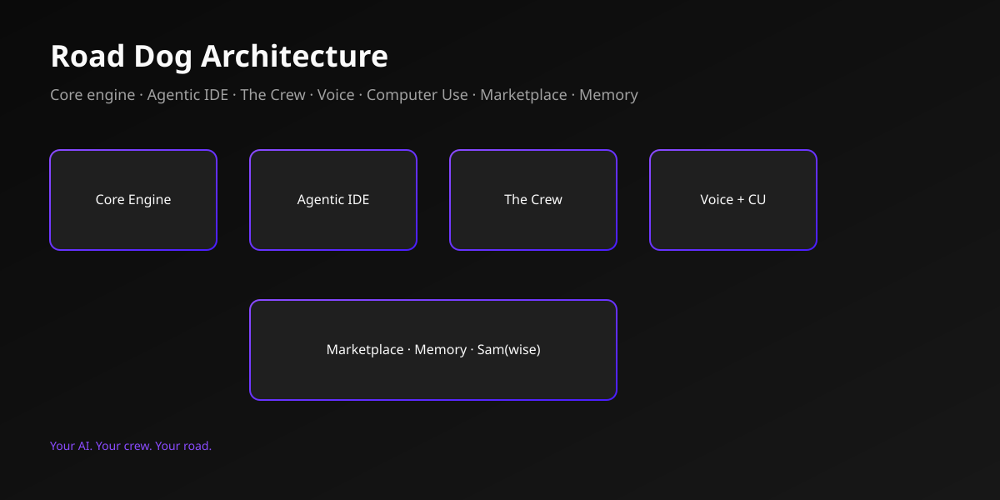

<h1 align="center">Road Dog</h1>

<p align="center">
  <strong>Your AI. Your crew. Your road.</strong><br />
  Sam(wise) is your AI agent companion for the desktop — coding agents, voice, computer use, agents, marketplace, memory.
</p>

<p align="center">
  <a href="https://github.com/tbwcheatwood-hue/Road-Dog/blob/main/LICENSE"></a>
  <a href="https://github.com/tbwcheatwood-hue/Road-Dog/actions/workflows/ci.yml"></a>
  <a href="https://discord.gg/x7USduHxbc"></a>
  <a href="https://github.com/tbwcheatwood-hue/Road-Dog/releases"></a>
  <a href="https://github.com/tbwcheatwood-hue/Road-Dog/stargazers"></a>
</p>

<p align="center">
  <a href="#quick-start">Quick Start</a> ·
  <a href="#features">Features</a> ·
  <a href="#samwise-your-ai-companion">Sam(wise)</a> ·
  <a href="#architecture">Architecture</a> ·
  <a href="#screenshots">Screenshots</a> ·
  <a href="https://github.com/tbwcheatwood-hue/Road-Dog/tree/main/docs">Docs</a> ·
  <a href="https://discord.gg/x7USduHxbc">Discord</a>
</p>

<p align="center">
  
  <br/>
  
  <br/><sub>Road Dog architecture — Core engine, Agentic IDE, The Crew, Voice, Computer Use, Marketplace and Memory.</sub>
</p>

---

Road Dog is one desktop app for everything AI can do on your computer. It has a workspace where several coding agents run side by side, AI agents that keep their own memory, a voice assistant with a wake word, control of your desktop and browser, and a plugin marketplace. It works with the models you already pay for, whether hosted, local or through a subscription you have.

You say what you want. Sam answers you, does the task on your computer, or hands it to the agent that fits, and you can watch every step.

It is free and open source, and it runs on your own machine. You do not need an account, and there is no cloud of ours between you and your models. It runs on Windows, macOS and Linux, and as a server without a screen.

## Quick Start

### One-line install (Windows / macOS / Linux)

```bash
# Windows (PowerShell)
irm https://raw.githubusercontent.com/tbwcheatwood-hue/Road-Dog/main/install/install.ps1 | iex

# macOS and Linux
curl -fsSL https://raw.githubusercontent.com/tbwcheatwood-hue/Road-Dog/main/install/install.sh | bash
```

The installer checks for Python 3.11+ and Git, offers to install whatever is missing, adds the desktop launcher and opens the app.

### Install from source

```bash
git clone https://github.com/tbwcheatwood-hue/Road-Dog.git
cd Road-Dog
pip install -e . --no-deps
pip install -r requirements.txt
cp jarvis.toml.example jarvis.toml   # config file name kept for compatibility
cp .env.example .env
```

### Launch

```bash
# Headless server (works on any machine, no display needed)
roaddog serve         # opens at http://localhost:8442
# (jarvis serve also works — same entry point, kept for compatibility)

# Full desktop app (Windows / macOS / Linux with a display)
roaddog               # or double-click the Road Dog desktop shortcut
# (jarvis also works)
```

On Linux without GTK/pywebview, `roaddog serve` runs headless and you open the printed address in your browser. A `roaddog.desktop` shortcut plus `roaddog-launch` wrapper are installed so Road Dog appears in your application menu.

### Connect a model

Open **API Keys & Providers** in the app and add your OpenAI, Anthropic, Gemini, OpenRouter, NVIDIA, Ollama or other key. Credentials stay in your OS credential store — never in config files. You need one API key, a subscription, or a local model; a microphone helps for voice but is optional. You do not need a GPU.

<p align="center">
  
  <br/><sub>Quick start flow: install → connect model → start using Sam</sub>
</p>

## Features

| | |
|---|---|
| **Sam(wise) — Your AI Companion** | A masculine, urban-inspired AI companion who feels like a trusted friend rather than a corporate chatbot. Loyal, resourceful, knowledgeable and dependable. Editable personality seed, persistent memory, configurable check-ins and reminders, quiet hours, male voice options, push-to-talk, optional wake word. |
| **Agentic IDE** | Run Claude Code, Codex, OpenCode, Cursor, Kimi Code, GLM, Grok Build, DeepSeek Harness, Kilo Code and Zed Code side by side in live terminal panes. Brief them by voice. |
| **The Crew** | Multi-agent collaboration interface with specialized roles — Commander, Architect, Developer, Debugger, Researcher, Tester, Reviewer, Documentation specialist. Visual dashboard, live status, shared scratchpads, structured handoffs, permission-controlled communication. |
| **Voice** | Wake word, live conversations, dictation into any app, phone calls. Interrupt mid-sentence. Local and hosted STT/TTS. Male voice options. Push-to-talk as first-class mode. |
| **Computer Use** | Sam clicks, types and reads your screen on desktop and browser. You decide what it may do — nothing acts without a live grant. |
| **Marketplace** | 40+ plugins, MCP servers, skills and CLI tools installed with one click — GitHub, Google Workspace, Notion, Slack, Linear, Spotify, Home Assistant and more. |
| **Any Model** | OpenAI, Anthropic, Gemini, OpenRouter, NVIDIA, Ollama and any local server, or your Claude and ChatGPT subscriptions. Pick a different model for each task. |
| **Memory** | A local wiki that Sam reads, writes and cites. Remembers context across chats, agents and days. |
| **Routines** | Work that repeats on a schedule — morning briefing, inbox sweep, nightly report. |
| **Appshots** | Press two keys to show Sam the window you are looking at, or just one area of it. |

<p align="center">
  
  <br/><sub>Feature overview: Sam, Agentic IDE, The Crew, Voice, Computer Use, Marketplace, Models, Memory, Routines, Appshots</sub>
</p>

## Sam(wise) — Your AI Companion

Sam is a masculine, urban-inspired AI companion designed to feel like a trusted friend on the road with you.

**Personality:**
- Loyal, resourceful, knowledgeable and dependable
- Relaxed, witty, conversational and confident
- Technically competent without being condescending
- Honest about mistakes, limitations and uncertainty
- Respectful without excessive flattery

**Example dialogue:**
- Startup: "What's good? Sam's online. Where we headed today?"
- Success: "Handled it. Everything checks out."
- Error: "Hold up, we hit a snag. Let's figure out what happened."
- Agent coordination: "The crew's working on it. Everybody's got their assignment."
- Permission required: "That's outside my clearance. Your call."
- Companionship: "You've been grinding for a while. How are you holding up?"

**Capability:**
- Editable personality seed (`SOUL.md`) — shape Sam's voice from day one
- Persistent personal memory — Sam remembers what matters across sessions
- Memory inspection, correction and deletion — you control what Sam knows
- User-editable personality settings — tune Sam's communication style
- Optional proactive companionship — check-ins and reminders
- Configurable quiet hours and notification controls
- Male voice selection — local and hosted options
- Push-to-talk as first-class interaction mode
- Optional configurable wake word — enabled by your choice only
- Protection against microphone and speaker feedback loops

Personality and memory never override security policies or permission boundaries.

## Coding Agents

Run every major coding CLI side by side in the Agentic IDE:

| Agent | Binary | Enable key | Status |
|---|---|---|---|
| Claude Code | `claude` | `CLAUDE_API_KEY` / sign-in | Built-in |
| Codex | `codex` | `CODEX_API_KEY` / sign-in | Built-in |
| OpenCode | `opencode` | sign-in | Built-in |
| Cursor CLI | `agent` / `cursor-agent` | `CURSOR_API_KEY` / `agent login` | Built-in |
| Kimi Code | `kimi` | sign-in | Built-in |
| GLM | `glm` | `ZAI_API_KEY` | Built-in |
| Grok Build | `grok` | sign-in | Built-in |
| Antigravity | `agy` | API Keys page | Built-in |
| DeepSeek Harness | `deepseek-harness` | API Keys page | Built-in |
| Kilo Code | `kilo` / `kilocode` | config file / `/connect` | Built-in |
| Z Code | `zcode` | config file / `zcode login` | Built-in |

## Architecture

<p align="center">
  
  <br/><sub>Road Dog architecture — Core engine, Agentic IDE, The Crew, Voice, Computer Use, Marketplace and Memory.</sub>
</p>

Road Dog follows a modular architecture:

- **Core Engine** — Event bus, config, plugins, security (risk tiers: safe/monitor/ask/block)
- **Brain Layer** — Pluggable LLM providers (10+ providers, any model, subscription + API keys)
- **Voice Pipeline** — Wake word → STT → Brain → TTS, with barge-in, echo guard, feedback protection
- **Agentic IDE** — Terminal panes spawning coding agents as harnesses via plugin entry-points
- **The Crew** — Multi-agent orchestration with role specialization and handoffs
- **Computer Use** — Screen capture + input automation with live permission grants
- **Marketplace** — One-click plugin/MCP/skill installs with browser-based OAuth
- **Memory** — Local wiki (Markdown + Git) with vector search and agent citations

## Screenshots

<p align="center">
  
  <br/><sub>Main desktop window with Agentic IDE, chat, and sidebar</sub>
</p>

<p align="center">
  
  <br/><sub>Agentic IDE running Claude Code, Codex, and OpenCode side by side</sub>
</p>

<p align="center">
  
  <br/><sub>The Crew dashboard with specialized agent roles and live status</sub>
</p>

<p align="center">
  
  <br/><sub>Voice settings: wake word, STT/TTS providers, push-to-talk, male voice options</sub>
</p>

<p align="center">
  
  <br/><sub>Marketplace with 40+ plugins, MCP servers, and skills</sub>
</p>

<p align="center">
  
  <br/><sub>Local wiki that Sam reads, writes, and cites across sessions</sub>
</p>

## Installation

### Windows (PowerShell)

```powershell
irm https://raw.githubusercontent.com/tbwcheatwood-hue/Road-Dog/main/install/install.ps1 | iex
```

### macOS and Linux

```bash
curl -fsSL https://raw.githubusercontent.com/tbwcheatwood-hue/Road-Dog/main/install/install.sh | bash
```

The installer checks for Python 3.11 or newer and Git, offers to install whatever is missing, adds the desktop launcher and opens the app.

### Headless server

```bash
pip install road-dog
jarvis serve
# or
roaddog serve
```

Then open `http://localhost:8442` in a browser.

### Desktop shortcut

A `roaddog.desktop` file is installed to `~/.local/share/applications/` so Road Dog appears in your desktop application menu. On Linux hosts without GTK/pywebview it launches the headless server (`jarvis serve`) and opens it in your browser; on hosts with a graphical desktop it launches the full app. A `~/.local/bin/roaddog-launch` wrapper handles the fallback.

## First-Run Onboarding

1. Finish the short setup in the app. Pick your language, a wake phrase (or keyboard shortcut instead) and one model.
2. Local-only operation is fully supported — no paid API credentials required.
3. Say your wake phrase and ask for something, for example "Plan a small project with me and ask what you need to know."
4. Open a project folder in the Agentic IDE, or create your first agent.

The first-run onboarding includes a diagnostic readiness dashboard covering:
- Model connectivity
- Inference capabilities
- Voice readiness
- Tool availability
- Agent availability
- Computer-use permissions
- Storage and memory availability
- Optional integrations

No paid inference requests are made during diagnostics without explicit approval.

## Documentation

- **Getting started:** [quick start](docs/product/start-here/first-run-setup.md), [app tour](docs/product/start-here/desktop-app-tour.md)
- **Installation:** [Windows setup](docs/install/windows.md), [Linux setup](docs/install/linux.md), [macOS setup](docs/install/macos.md), [headless server](docs/headless-server.md)
- **Sam(wise):** [personality configuration](docs/sam/personality.md), [voice configuration](docs/sam/voice.md)
- **Everyday use:** [voice](docs/product/everyday-use/voice-conversations.md), [dictation](docs/product/everyday-use/dictation.md), [memory](docs/product/knowledge-and-sharing/wiki-and-memory.md)
- **Agents and automation:** [agentic IDE](docs/product/extend-and-automate/agentic-ide.md), [The Crew](docs/crew/overview.md), [computer use](docs/product/extend-and-automate/computer-use.md), [plugins](docs/product/extend-and-automate/plugins.md), [MCP](docs/product/extend-and-automate/mcp-connections.md), [CLI](docs/jarvis-cli.md) (CLI still accepts `jarvis` / `roaddog` / `road-dog`)
- **Models:** [providers](docs/product/personalize-and-connect/providers-and-api-keys.md), [local models](docs/product/personalize-and-connect/local-ai-providers.md)
- **Resource management:** [cost controls](docs/resource/cost-controls.md), [usage dashboard](docs/resource/usage-dashboard.md)
- **Running and fixing:** [server](docs/headless-vps-deployment.md), [architecture](docs/architecture-overview.md), [troubleshooting](docs/product/privacy-safety-and-support/troubleshooting.md)
- **Security:** [security and permissions](docs/security/overview.md), [privacy](docs/product/privacy-safety-and-support/privacy-and-local-data.md)

## CLI Reference

Road Dog provides three equivalent CLI entry points:

| Command | Description |
|---|---|
| `roaddog` | Primary entry point — Road Dog branding |
| `road-dog` | Alternative hyphenated form |
| `jarvis` | Compatibility alias (preserved for existing users/scripts) |

All three commands share the same help, flags, and subcommands:

```bash
roaddog --help          # Show help
roaddog serve           # Start headless server
roaddog --wizard        # Re-run setup wizard
roaddog --doctor        # System health check
roaddog --readiness     # First-run readiness dashboard
roaddog update          # Update to latest version
```

The control CLI for a running instance:

```bash
jarvisctl               # or jctl (short alias)
jarvisctl brain switch grok
jarvisctl mcp add <name> <url>
jarvisctl missions list
```

## Compatibility

- **Python package name:** `road-dog` (PyPI)
- **Config file:** `jarvis.toml` (preserved for compatibility)
- **Data directory:** `~/.road-dog/` (new installs) / `~/.jarvis/` (migrated)
- **CLI aliases:** `jarvis`, `roaddog`, `road-dog` all work
- **Upstream attribution:** Preserved in `NOTICE` and `THIRD_PARTY_NOTICES.txt`

## Contribute

A good place to start is a [good first issue](https://github.com/tbwcheatwood-hue/Road-Dog/issues?q=is%3Aissue+is%3Aopen+label%3A%22good+first+issue%22). Questions and ideas go to [discussions](https://github.com/tbwcheatwood-hue/Road-Dog/discussions), and security reports follow [SECURITY.md](SECURITY.md).

If you are an AI agent helping with this repository, read [`AGENTS.md`](AGENTS.md) first.

If Road Dog is useful to you, a star on GitHub helps other people find it.

## License

[Apache 2.0](https://github.com/tbwcheatwood-hue/Road-Dog/blob/main/LICENSE). Upstream attribution and license notices are preserved in [NOTICE](NOTICE) and [THIRD_PARTY_NOTICES.txt](jarvis/ui/web/frontend/public/THIRD_PARTY_NOTICES.txt).