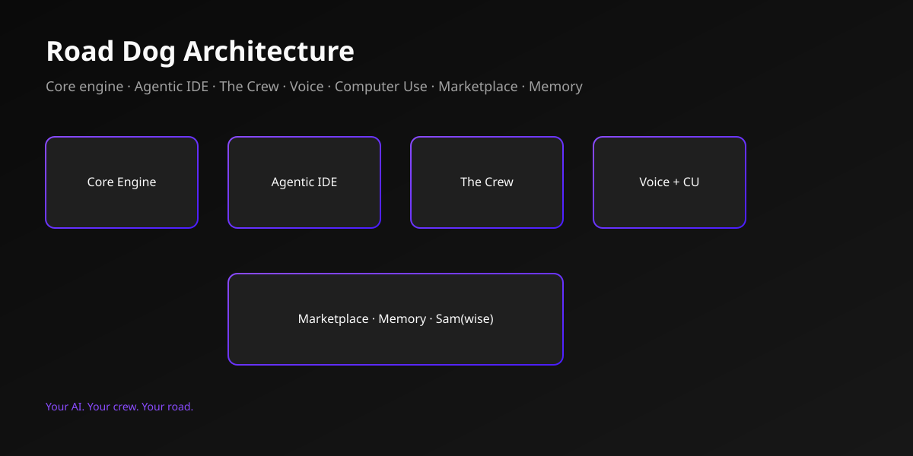

<h1 align="center">Road Dog</h1>

<p align="center">
  <a href="https://github.com/tbwcheatwood-hue/Road-Dog/blob/main/README.md">English</a> ·
  <strong>简体中文</strong>
</p>

<p align="center">
  <strong>开源的桌面 AI 智能体超级应用。</strong><br />
  同时驱动所有编程智能体进行 Vibe Coding，用语音和电脑对话，再组建一支在你休息时也持续工作的 AI 智能体团队。
</p>

<p align="center">
  <a href="https://pypi.org/project/road-dog/"></a>
  <a href="https://github.com/tbwcheatwood-hue/Road-Dog/blob/main/LICENSE"></a>
  <a href="https://github.com/tbwcheatwood-hue/Road-Dog/actions/workflows/ci.yml"></a>
  <a href="https://discord.gg/x7USduHxbc"></a>
</p>

<p align="center">
  <a href="#安装">安装</a> ·
  <a href="https://roaddog.ai">官网</a> ·
  <a href="https://github.com/tbwcheatwood-hue/Road-Dog/blob/main/docs/product/start-here/welcome-to-roaddog.md">文档</a> ·
  <a href="https://discord.gg/x7USduHxbc">Discord</a> ·
  <a href="https://x.com/Ruben_Luetke">X</a>
</p>

https://github.com/user-attachments/assets/42afcb9f-323b-4a57-9b6d-17aa7a2585b2

<p align="center"><sub>一段真实、未经剪辑的应用录屏（带声音）：用语音和 Sam 交谈、把工作交给智能体，并在编程工作区里跟进它们的进度。</sub></p>

---

Road Dog 不是又一个聊天窗口。它是一款桌面应用，把 AI 在电脑上能做的一切汇集到一处：
多智能体编程工作区、拥有独立记忆的常驻 AI 智能体、带唤醒词的语音助手、桌面与浏览器操控、插件市场，
以及你已经付费的所有模型——云端模型、本地模型或你现有的订阅。

你说出想要什么。Sam 会直接回答、在你的电脑上把事情做完，或者交给合适的智能体——每一步你都看得见。

**免费、开源，在你自己的电脑上运行。** 无需注册账号，中间也没有我们的云服务。
支持 Windows、macOS 和 Linux，另有无界面的服务器模式。

> **界面语言：** 桌面应用提供简体中文界面。可在首次启动的设置窗口中选择“中文”，
> 也可以随时在“设置 > 语言”中切换。

## 功能一览

| | |
|---|---|
| **Agentic IDE** | 在实时终端窗格中并排运行 Claude Code、Codex、OpenCode、Kimi Code、GLM、Grok Build、Antigravity、Cursor CLI 和 DeepSeek Harness——你的电脑能承载多少就开多少。还能用语音给它们布置任务。 |
| **The Crew** | 多智能体协作界面，包含指挥官、架构师、开发者、调试员、研究员、测试员、审查员、文档专家等专业角色。可视化仪表盘、实时状态、共享草稿、结构化交接、权限控制的通信。 |
| **语音** | 唤醒词、实时对话、向任意应用听写、电话通话。可随时打断。本地和云端 STT/TTS。男声选项。按住说话作为一等公民模式。 |
| **Computer Use** | Sam 点击、输入并读取你的桌面和浏览器屏幕。由你决定它能做什么——没有实时授权什么都不会发生。 |
| **市场** | 40+ 插件、MCP 服务器、技能和 CLI 工具一键安装——GitHub、Google Workspace、Notion、Slack、Linear、Spotify、Home Assistant 等。 |
| **任意模型** | OpenAI、Anthropic、Gemini、OpenRouter、NVIDIA、Ollama 和任意本地服务器，或你的 Claude 和 ChatGPT 订阅。为每个任务选择不同模型。 |
| **记忆** | 一个 Sam 能读、写、引用的本地 Wiki。跨聊天、智能体和天数保持上下文。 |
| **例程** | 按计划重复的工作——晨间简报、收件箱清理、夜间报告。 |
| **Appshots** | 两键让 Sam 看到你正在看的窗口，或仅其中一部分。 |

## Sam(wise) — 你的 AI 伙伴

Sam 不只是一个助手——Sam 是你的伙伴。给 Sam 一个名字，选择唤醒词，看着 Sam 通过 SOUL.md 文件学习你的偏好、工作流和怪癖。Sam 会记住，并在每次对话、每个智能体、每一天中应用这些记忆。

| 特性 | 详情 |
|------|------|
| **唤醒词** | 自定义（默认："Hey Sam"）|
| **语音** | 本地/云端 STT & TTS，男声/女声选项 |
| **记忆** | 本地 Wiki (SOUL.md) + 语义搜索 |
| **人格** | 通过 SOUL.md 自我演化 |
| **工具** | 完整桌面/浏览器控制 |

## 快速开始

### 安装

```bash
# 一键安装（Linux/macOS/WSL）
curl -fsSL https://roaddog.ai/install | bash

# 或通过 pip
pip install road-dog

# 启动
roaddog
```

### 首次运行
1. `roaddog` 启动设置向导
2. 选择语言（中文/英文）
3. 设置唤醒词（默认："Hey Sam"）
4. 连接模型（Claude Max、ChatGPT Plus、API 密钥或本地模型）
5. 完成！

## 架构

<p align="center">
  
  <br/><sub>Road Dog 架构 — 核心引擎、Agentic IDE、The Crew、语音、Computer Use、市场和记忆。</sub>
</p>

Road Dog 遵循模块化架构：

- **核心引擎** — 事件总线、配置、插件、安全（风险等级：安全/监控/询问/阻止）
- **大脑层** — 可插拔 LLM 提供商（10+ 提供商，任意模型，订阅 + API 密钥）
- **语音管道** — 唤醒词 → STT → 大脑 → TTS，支持打断、回声防护、反馈保护
- **Agentic IDE** — 通过插件入口点生成编码智能体的终端窗格

## 编程智能体 (Agentic IDE)

Road Dog 并排运行所有主要的编程智能体，每个都在自己的终端窗格中：

| 智能体 | 命令 | 认证 | 状态 |
|--------|------|------|------|
| Claude Code | `claude` | 订阅 / `CLAUDE_CONFIG_DIR` | 内置 |
| Codex | `codex` | `OPENAI_API_KEY` / 登录 | 内置 |
| OpenCode | `opencode` | 登录 | 内置 |
| Cursor CLI | `agent` / `cursor-agent` | `CURSOR_API_KEY` / `agent login` | 内置 |
| Kilo Code | `kilo` / `kilocode` | 配置文件 / `/connect` | 内置 |
| Kimi Code | `kimi` | 登录 | 内置 |
| GLM | `glm` | `ZAI_API_KEY` | 内置 |
| Grok Build | `grok` | 登录 | 内置 |
| Antigravity | `agy` | API Keys 页面 | 内置 |
| DeepSeek Harness | `deepseek-harness` | API Keys 页面 | 内置 |
| Z Code | `zcode` | 配置文件 / `zcode login` | 内置 |

## 社区

- **Discord:** https://discord.gg/x7USduHxbc
- **GitHub Issues:** https://github.com/tbwcheatwood-hue/Road-Dog/issues
- **文档:** https://github.com/tbwcheatwood-hue/Road-Dog/tree/main/docs

## 许可证

Apache 2.0 — 详见 [LICENSE](LICENSE) 和 [NOTICE](NOTICE)。

---

*Road Dog — Your AI. Your crew. Your road.*